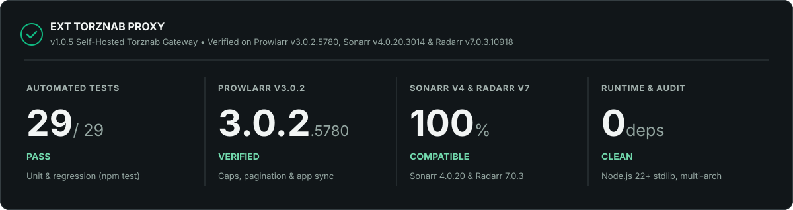
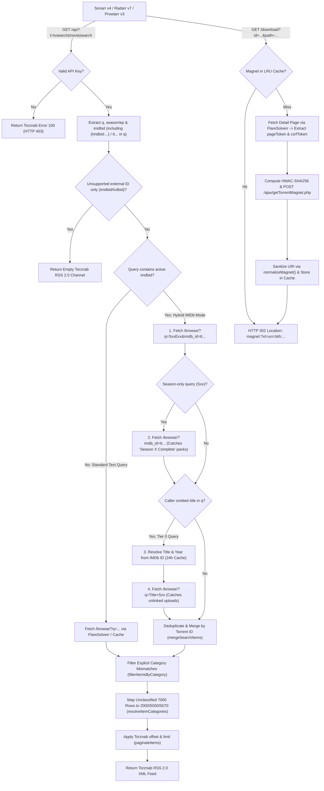

# 🌐 EXT Torznab Proxy

[](https://github.com/huseyincig/extto-torznab-proxy/releases)
[](https://github.com/huseyincig/extto-torznab-proxy/pkgs/container/extto-torznab-proxy)
[](#-verification--live-arr-stack-acceptance)
[](#-verification--live-arr-stack-acceptance)
[](#-verification--live-arr-stack-acceptance)
[](test/server.test.js)
[](package.json)
[](LICENSE)

[Verification & Compatibility](#-verification--live-arr-stack-acceptance) · [Key Highlights](#-key-highlights) · [Deployment (Docker Compose)](#-deployment-docker-compose) · [Prowlarr, Sonarr & Radarr Setup](#-prowlarr-sonarr--radarr-setup) · [Architecture & Search Lifecycle](#-architecture--hybrid-imdb-search-lifecycle) · [Web UI & Configuration](#️-web-ui--configuration) · [HTTP & Torznab Endpoints](#-http--torznab-endpoints) · [Validation & Testing](#-validation--testing)

A high-performance, zero-dependency, self-hosted **Generic Torznab** gateway for EXT-style torrent search pages (`extranet.torrentbay.st`, `ext.to`), purpose-built for the **\*arr stack** (**Prowlarr**, **Sonarr**, and **Radarr**) and **qBittorrent RSS** automation.

**EXT Torznab Proxy** manages persistent **FlareSolverr** (or compatible endpoints such as **Byparr**) sessions and Cloudflare warm cycles internally, translates \*arr queries (including hybrid **IMDb ID + title resolution**, **Full Season Packs**, **Daily Series**, and **Anime**), supports native EXT **uploader, category, age, and sort filtering** for custom RSS feeds, resolves magnets on-demand at download time, and exposes a native Generic Torznab feed—requiring **zero custom Prowlarr YAML definition files**.

---

## 📊 Verification & Live \*arr Stack Acceptance



> EXT Torznab Proxy **v1.0.7** was verified on **22 November 2026** against a live **\*arr stack** (**Prowlarr `v3.0.2.5780`**, **Sonarr `v4.0.20.3014`**, and **Radarr `v7.0.3.10918`**) running on **Node.js `22+`**.

- **Automated Unit & Regression Suite:** **39 / 39** tests passing (`npm test`), covering Torznab `<caps>`, hybrid IMDb + title search merging, Prowlarr `{ImdbId:...}` & `q=tt...` extraction, unsupported external ID (`tmdbid`/`tvdbid`) protection, EXT `/browse/` filter & sort forwarding (`user_nick`, `sort`, `order`, `age`, `ext_cat`, `sub_cat`, `page`, `with_adult`), unclassified (`7000`) category resolution, pagination (`offset`/`limit`), season-to-episode token upgrading, daily series formatting (`YYYY.MM.DD`), audio/codec dot preservation (`DDP5.1`, `7.1`, `H.264`, `H.265`), 8-language Web UI parity & `<script>` VM compilation, RFC 7230 magnet `Location` header normalization, HTML entity/date/size edge cases, and FlareSolverr error diagnostics.
- **Live Prowlarr, Sonarr & Radarr Acceptance:** End-to-end indexer synchronization, interactive season/episode searches, full season pack matching (`S01` and `"Season 1 Complete"`), and multi-quality movie searches verified against live Prowlarr, Sonarr, and Radarr instances.
- **Zero External Runtime Dependencies:** Built strictly on the Node.js `>=22` standard library (`http`, `crypto`, `fs`, native `fetch`) and packaged as a lightweight multi-arch (`linux/amd64`, `linux/arm64`) Alpine Docker image.

### Verified \*arr Stack Compatibility Matrix

| Component | Verified Version | Runtime | Verified Integration & Capabilities |
| :--- | :---: | :---: | :--- |
| **Prowlarr** | `v3.0.2.5780` | `.NET 10.0.15` | `Generic Torznab` indexer validation, `<limits max="100" default="100" />` single-page sync, `{ImdbId:...}` / `q=tt...` manual search extraction, category mapping (`2000`, `5000`, `5070`), unclassified (`7000`) category resolution (`ReleaseSearchService.cs:222` pass-through), and full App Sync to Sonarr & Radarr. |
| **Sonarr** | `v4.0.20.3014` | `.NET 6.0.13` | Tier 0 `imdbid` + `season`/`ep` (`SxxExx`) searches, hybrid IMDb title resolution + text search merging, `"Season X Complete"` & `Sxx` Full Season Pack detection, Special (`S00Exx`) & Daily (`YYYY.MM.DD`) episode searches. |
| **Radarr** | `v7.0.3.10918` | `.NET 10.0.15` | `t=movie&imdbid=tt...` hybrid IMDb + resolved `"Title Year"` search merging, year-disambiguated release matching, and multi-quality codec/audio tag parsing (`2160p REMUX`, `TrueHD 7.1`, `DDP5.1`, `H.264`, `H.265`). |
| **FlareSolverr / Byparr** | `v3.3.21+` / `latest` | Chromium / Python | Persistent session (`sessions.create`), mutex-serialized request queue (`withFsLock`), automatic session recreation on expiry, background Cloudflare warm timer, and configurable `FLARESOLVERR_URL`. |

See the [1.0.7 release notes](CHANGELOG.md) for custom EXT filtering & sorting options (`user_nick`, `sort`, `order`, `age`, `ext_cat`), the interactive Web UI RSS Feed URL Builder, 8-language Web UI localization, and hybrid IMDb search.

---

## ✨ Key Highlights

- **Zero-YAML Generic Torznab Integration:** Adds directly to **Prowlarr** (or straight to **Sonarr** / **Radarr**) as a standard `Generic Torznab` indexer. No custom Cardigann YAML definitions or Prowlarr FlareSolverr proxy tags required.
- **Hybrid IMDb ID (`imdbid`) + Title Search Engine:**
  - When `enableImdbSearch` is enabled (default: `true`), advertises `supportedParams="q,imdbid"` for `movie-search` and `supportedParams="q,season,ep,imdbid"` for `tv-search`, and also extracts `{ImdbId:tt...}` or `tt1234567` tokens passed inside `q` from Prowlarr manual searches (without misclassifying numeric titles like `90210` or `1917`).
  - Prevents the **Sonarr/Radarr Tier 0 trap** (`if (releases.Any()) break;`): when Sonarr or Radarr queries by `imdbid` without `q` (title), the proxy automatically queries `imdb_id=tt...`, fetches full season packs without `q=Sxx` for season queries, resolves the official title/year from the IMDb ID (cached for 24 hours), runs a complementary title search, and merges all unique results by torrent ID.
  - Attaches `<torznab:attr name="imdb">` and `<torznab:attr name="imdbid">` strictly to items verified by the `imdb_id` query so Sonarr and Radarr perform natural title validation on merged text-search items.
  - Safely returns an empty Torznab `<channel>` when queried by unsupported external IDs (`tmdbid`, `tvdbid`, `tvmazeid`, `rid`) without a title `q`, never leaking fallback `"warm"` results into automated grabs.
- **Prowlarr-Safe Unclassified (`7000`) Category Resolution:** Automatically maps rows on EXT that lack an explicit `/movies/`, `/tv/`, or `/anime/` anchor (`7000`) to the appropriate advertised Torznab category (`2000` Movies, `5000` TV, or `5070` Anime) based on request context and title heuristics (`S01`, `Season 1`, `S01E01`), ensuring Prowlarr's `ReleaseSearchService.cs` never drops valid results during category-filtered searches.
- **Smart TV, Season Pack & Daily Episode Normalization:**
  - Converts `"Season 2 Episode 4"`, `"Season 2 Ep 4"`, `"S2E4"` $\rightarrow$ `"S02E04"` and `"Season 2"` $\rightarrow$ `"S02"`.
  - Upgrades season-only tokens in `q` (`Season 2` / `S02`) to `S02E04` when both `season` and `ep` query parameters are supplied.
  - Formats Sonarr daily series queries (`season=2026&ep=11/18`) into standard `2026.11.18` tokens.
- **Codec, Audio Channel & Date Dot Preservation:** Preserves release-critical dots in audio channel tags (`5.1`, `7.1`, `2.0`, `DDP5.1`, `AAC2.0`, `DD+5.1`), video codecs (`H.264`, `H.265`), and daily dates (`YYYY.MM.DD`) during title normalization so Sonarr/Radarr custom formats and quality profiles score releases accurately.
- **On-Demand Magnet Resolution & RFC 7230 Header Safety:** Search queries only parse the lightweight `/browse/` HTML table. Detail-page token extraction (`pageToken`, `csrfToken`, HMAC-SHA256) and `/ajax/getTorrentMagnet.php` resolution execute **only** when a release is actually grabbed (`/download`), returning an RFC 7230-compliant `302 Location: magnet:?...` redirect sanitized by `normalizeMagnet()`.
- **Mutex-Serialized FlareSolverr Session & Auto-Warmer:** Queues concurrent FlareSolverr calls behind an internal lock (`withFsLock`) to prevent Chromium tab stampedes during multi-season searches, while a configurable background warm timer keeps the Cloudflare clearance cookie (`cf_clearance`) hot.
- **Native EXT Filtering, Sorting & Interactive RSS Feed URL Builder:** Supports custom `/api?t=search` filter and sort parameters (`user_nick` / `uploader`, `sort`, `order`, `age`, `ext_cat` / `site_cat`, `sub_cat`, `page`, `with_adult`) without requiring a search keyword `q`, plus an interactive **"RSS & Filtered Feed URL Builder (qBittorrent / RSS)"** card in the Web UI with live URL generation, one-click clipboard copy, and direct XML preview.
- **Auto-Detected Multilingual Web UI (8 Languages):** Built-in responsive dashboard at `http://YOUR_HOST_IP:8998/` automatically adapts to your browser's language (`navigator.languages` / `navigator.language`: **English (`en`)**, **Turkish (`tr`)**, **Spanish (`es`)**, **Russian (`ru`)**, **Portuguese (`pt`)**, **French (`fr`)**, **German (`de`)**, and **Polish (`pl`)**) with live warm telemetry, one-click API key copy/regeneration, RSS Feed URL Builder, cache clearing, session reset, and instant settings persistence.

---

## 📦 Deployment (Docker Compose)

Create a `docker-compose.yml` file to deploy **EXT Torznab Proxy** alongside **FlareSolverr** (or a FlareSolverr-compatible service such as **Byparr**):

```yaml
services:
  flaresolverr:
    image: ghcr.io/flaresolverr/flaresolverr:latest
    container_name: flaresolverr
    environment:
      - TZ=Europe/Istanbul
    shm_size: "1gb"
    restart: unless-stopped

  extto-torznab-proxy:
    image: ghcr.io/huseyincig/extto-torznab-proxy:latest
    container_name: extto-torznab-proxy
    depends_on:
      - flaresolverr
    environment:
      - TZ=Europe/Istanbul
      - PORT=8998
      - CONFIG_DIR=/config
      - FLARESOLVERR_URL=${FLARESOLVERR_URL:-http://flaresolverr:8191/v1}
    ports:
      - "8998:8998"
    volumes:
      - ./config:/config
    healthcheck:
      test: ["CMD-SHELL", "wget -qO- http://127.0.0.1:8998/health >/dev/null || exit 1"]
      interval: 120s
      timeout: 10s
      retries: 3
      start_period: 60s
    restart: unless-stopped
    logging:
      driver: json-file
      options:
        max-size: "10m"
        max-file: "3"
```

Start the stack:

```bash
docker compose up -d
```

For a pinned release version, use:

```yaml
image: ghcr.io/huseyincig/extto-torznab-proxy:1.0.7
```

### 🌐 Optional Container Environment Variables

When set in `docker-compose.yml`, the following environment variables are automatically applied to `/config/config.json` on startup:

| Environment Variable | Default | Description |
| :--- | :---: | :--- |
| `PORT` | `8998` | HTTP listening port inside the container. |
| `CONFIG_DIR` | `/config` | Directory where `config.json` is persisted. |
| `FLARESOLVERR_URL` | *(From `config.json`)* | Overrides `flaresolverrUrl` on startup (e.g. `http://flaresolverr:8191/v1` or `http://byparr:8191/v1`). |
| `BASE_URL` | *(From `config.json`)* | Overrides `baseUrl` on startup (e.g. `https://extranet.torrentbay.st` or `https://ext.to`). |
| `PUBLIC_URL` | *(From `config.json`)* | Overrides `publicUrl` on startup (e.g. `http://192.168.1.50:8998`). |
| `SESSION_NAME` | *(From `config.json`)* | Overrides `sessionName` on startup. |
| `API_KEY` | *(From `config.json`)* | Overrides `apiKey` on startup. |

> [!IMPORTANT]
> The container automatically generates `/config/config.json` with a random 192-bit API key on first startup. Do **not** commit `/config/config.json` to a public repository.

---

## 🔌 Prowlarr, Sonarr & Radarr Setup

### 1. Adding to Prowlarr (`v3.0.2+` — Recommended)

In Prowlarr, navigate to **Indexers $\rightarrow$ Add Indexer** and select **Generic Torznab**:

| Field | Value | Notes |
| :--- | :--- | :--- |
| **Name** | `EXT Torznab Proxy` | Or any custom name |
| **Enable** | `Yes` (Checked) | Enables RSS, Automatic, and Interactive Search |
| **Redirect** | `No` (Unchecked) | Leave disabled; `/download` handles `302` magnet redirects |
| **URL** | `http://YOUR_HOST_IP:8998` | Or `http://extto-torznab-proxy:8998` if on the same Docker network |
| **API Path** | `/api` | Default Torznab API path |
| **API Key** | *(Copy from Web UI)* | Shown at `http://YOUR_HOST_IP:8998/` |
| **Categories** | `Movies (2000)`, `TV (5000)`, `Anime (5070)` | Auto-discovered from `/api?t=caps` |
| **Tags** | *(Leave empty)* | **Do NOT** assign a Prowlarr FlareSolverr proxy tag |

> [!WARNING]
> **Do not** attach a FlareSolverr Indexer Proxy tag to this indexer in Prowlarr. **EXT Torznab Proxy** communicates with FlareSolverr directly and manages its own persistent browser session.

### 2. Synchronizing with Sonarr (`v4+`) & Radarr (`v7+`)

When Prowlarr's **Settings $\rightarrow$ Apps** is configured with **Full Sync** for Sonarr and Radarr:
- **Sonarr (`v4.0.20+`)** automatically receives categories `5000 (TV)` and `5070 (Anime)` along with `tv-search` (`q,season,ep,imdbid`).
- **Radarr (`v7.0.3+`)** automatically receives category `2000 (Movies)` along with `movie-search` (`q,imdbid`).

---

## 🔄 Architecture & Hybrid IMDb Search Lifecycle



---

## ⚙️ Web UI & Configuration

Open the built-in management interface in your browser:

```text
http://YOUR_HOST_IP:8998/
```

The Web UI automatically detects your browser's language (**English**, **Turkish**, **Spanish**, **Russian**, **Portuguese**, **French**, **German**, or **Polish**) and provides live status cards (**Warm Status**, **Last Warm Age**, **Last Warm Duration**, **Search Cache Count**, **Magnet Cache Count**), quick action buttons (**Run Warm**, **Clear Cache**, **Reset Session**, **Health JSON**, **Caps XML**), and persistent configuration controls.

### `/config/config.json` Reference

```json
{
  "baseUrl": "https://extranet.torrentbay.st",
  "publicUrl": "http://YOUR_HOST_IP:8998",
  "flaresolverrUrl": "http://flaresolverr:8191/v1",
  "sessionName": "extto_persistent",
  "apiKey": "change-me",
  "withAdult": true,
  "warmEnabled": true,
  "warmQuery": "warm",
  "warmIntervalMinutes": 10,
  "coldThresholdSeconds": 30,
  "requestTimeoutMs": 120000,
  "idleTimeoutMinutes": 360,
  "searchTtlSeconds": 180,
  "magnetTtlMinutes": 1440,
  "maxSearchCacheItems": 100,
  "maxMagnetCacheItems": 1000,
  "stripSeasonFromSearch": true,
  "enableImdbSearch": true
}
```

### 🎛️ Configuration Options

| Setting | Default | Description |
| :--- | :---: | :--- |
| `baseUrl` | `"https://extranet.torrentbay.st"` | Target EXT mirror domain (`https://extranet.torrentbay.st`, `https://ext.to`, etc.). |
| `publicUrl` | `""` | External base URL (`http://YOUR_HOST_IP:8998`) used to construct `<link>` and `<enclosure>` `/download` URLs in Torznab XML. Falls back to `X-Forwarded-Proto` / `X-Forwarded-Host` / `Host` headers if empty. |
| `flaresolverrUrl` | `"http://flaresolverr:8191/v1"` | FlareSolverr (or compatible service such as Byparr) `/v1` API endpoint. |
| `sessionName` | `"extto_persistent"` | Persistent FlareSolverr browser session identifier. |
| `apiKey` | *(Auto-generated)* | Torznab API key required by `/api` requests (`?apikey=...`). Can be copied or regenerated instantly from the Web UI. |
| `enableImdbSearch` | `true` | Advertises `imdbid` in `/api?t=caps` (`movie-search` and `tv-search`) and enables the Hybrid IMDb + Title search engine. |
| `stripSeasonFromSearch` | `true` | Normalizes verbose TV queries (`"Season 2 Ep 4"` $\rightarrow$ `"S02E04"`, `"Season 2"` $\rightarrow$ `"S02"`) and strips colons for optimal EXT search matching. |
| `withAdult` | `true` | Appends `with_adult=1` (`true`) or `with_adult=0` (`false`) to upstream `/browse/` requests. |
| `warmEnabled` | `true` | Enables periodic background warming to keep the Cloudflare session active. |
| `warmQuery` | `"warm"` | Fallback search term used by the warm timer and empty queries. |
| `warmIntervalMinutes` | `10` | Interval in minutes between background warm runs (`1`–`1440`). |
| `coldThresholdSeconds` | `30` | Duration threshold in seconds above which a warm run is reported as `COLD_OR_CHALLENGE`. |
| `requestTimeoutMs` | `120000` | Maximum timeout in milliseconds for FlareSolverr and upstream magnet AJAX calls (`15000`–`300000`). |
| `idleTimeoutMinutes` | `360` | Destroys and recycles the persistent FlareSolverr session after this many minutes of inactivity (`5`–`10080`). |
| `searchTtlSeconds` | `180` | TTL in seconds for cached `/browse/` HTML responses (`10`–`86400`). |
| `magnetTtlMinutes` | `1440` | TTL in minutes for cached resolved magnet URIs (`1`–`43200`). |
| `maxSearchCacheItems` | `100` | Maximum LRU entries in the search HTML cache (`10`–`5000`). |
| `maxMagnetCacheItems` | `1000` | Maximum LRU entries in the resolved magnet cache (`10`–`50000`). |

---

## 🌐 HTTP & Torznab Endpoints

| Endpoint | Method | Purpose |
| :--- | :---: | :--- |
| `/` | `GET` | Multilingual (8-language) Web UI dashboard and settings form |
| `/settings` | `POST` | Saves configuration changes from the Web UI |
| `/api-key/regenerate` | `POST` | Generates and persists a new random 192-bit API key immediately |
| `/health` | `GET` | JSON health, session, cache, and warm telemetry endpoint (Docker `HEALTHCHECK` target) |
| `/warm` | `GET` / `POST` | Triggers an immediate Cloudflare warm run (bypasses local search cache) |
| `/cache/clear` | `GET` / `POST` | Clears in-memory search HTML, resolved magnet, and IMDb title LRU caches |
| `/session/reset` | `GET` / `POST` | Destroys and recreates the persistent FlareSolverr session |
| `/api?t=caps` | `GET` | Torznab capabilities XML (`limits`, `searching`, `categories`) |
| `/api?t=search&...` | `GET` | General Torznab search & filtered RSS feed (`q`, `{ImdbId:...}`, `user_nick`, `sort`, `order`, `age`, `ext_cat`, `sub_cat`, `page`, `with_adult`, `cat`, `offset`, `limit`, `apikey`) |
| `/api?t=tvsearch&...` | `GET` | Torznab TV search (`q`, `season`, `ep`, `imdbid`, `cat`, `offset`, `limit`, `apikey`) |
| `/api?t=movie&...` | `GET` | Torznab Movie search (`q`, `imdbid`, `cat`, `offset`, `limit`, `apikey`) |
| `/download?id=...&path=...` | `GET` | Resolves the torrent's magnet URI on-demand and returns an `HTTP 302` redirect |

### 📡 Custom RSS & EXT Filtering / Sorting Parameters (`qBittorrent / RSS`)

In addition to standard \*arr queries, `/api?t=search` supports native EXT `/browse/` filtering and sorting parameters for **qBittorrent RSS** feeds and external Torznab clients. When any filter or sort parameter below is supplied, `q` is optional (the proxy will **not** inject `q=warm`). You can also build and preview these URLs visually from the **"RSS & Filtered Feed URL Builder (qBittorrent / RSS)"** card in the Web UI:

| Query Parameter | Accepted Values | Description |
| :--- | :--- | :--- |
| `user_nick` *(or `uploader`)* | `PSA`, `QxR`, `MeGusta`, ... | Filter uploads by EXT uploader nickname (`1`–`64` characters). |
| `sort` | `age`, `seed`, `leech`, `size`, `files`, `comments` | Sort upstream results (also accepts aliases: `created`/`date`/`time` $\rightarrow$ `age`, `seeds`/`seeders` $\rightarrow$ `seed`, `leechs`/`leechers`/`peers` $\rightarrow$ `leech`). |
| `order` | `desc`, `asc` | Sort direction (defaults to `desc` when `sort` is set). |
| `age` | `0`, `1`, `2`, `3`, `4` | Upload time range (`0` = 24h, `1` = 3 days, `2` = 1 week, `3` = 2 weeks, `4` = 1 month). |
| `ext_cat` *(or `site_cat`)* | `1`–`8`, `10` | Native EXT category ID (`1` = Movies, `2` = TV, `3` = Music, `4` = Games, `5` = Applications, `6` = Books, `7` = Anime, `8` = Other, `10` = XXX). Also accepted via `cat=1..10`. |
| `sub_cat` | `1`–`999` | Native EXT subcategory ID (e.g. `3` = Dual Audio, `53` = 4K/UHD, `65` = 3D). |
| `page` | `1`–`100` | Upstream `/browse/` page number. |
| `with_adult` | `0`, `1`, `false`, `true` | Per-request adult content override without altering global settings. |

Example qBittorrent RSS feed URL (latest Movie uploads from uploader `PSA`, sorted by seeders descending):

```text
http://YOUR_HOST_IP:8998/api?t=search&apikey=YOUR_API_KEY&user_nick=PSA&ext_cat=1&sort=seed&order=desc
```

---

## 🧪 Validation & Testing

Run the automated test suite locally (requires Node.js `>=22`):

```bash
npm test
```

Build the container image locally:

```bash
docker build -t extto-torznab-proxy:latest .
```

### Publishing Multi-Arch Images (GHCR)

This repository includes GitHub Actions workflows (`.github/workflows/ci.yml` and `.github/workflows/docker-publish.yml`) that run the unit test suite and publish multi-architecture (`linux/amd64`, `linux/arm64`) images to GitHub Container Registry:

```text
ghcr.io/huseyincig/extto-torznab-proxy:latest
ghcr.io/huseyincig/extto-torznab-proxy:1.0.7
```

Push a version tag to trigger a release build:

```bash
git tag v1.0.7
git push origin v1.0.7
```

---

## 🏗️ Project Layout

- `server.js`: Zero-dependency HTTP server, Torznab XML generator, Hybrid IMDb + Title search engine, HTML result parser, HMAC magnet resolver, FlareSolverr mutex queue, warm scheduler, and 8-language Web UI.
- `test/server.test.js`: Unit and regression test suite covering Torznab `<caps>`, hybrid IMDb search, `{ImdbId:...}` extraction, environment variable overrides, 8-language UI parity, category filtering & `7000` resolution, pagination, date/size/title normalization, and FlareSolverr diagnostics.
- `test/normalize-magnet.test.js`: RFC 7230 `Location` header safety and magnet URI normalization test suite.
- `examples/docker-compose.yml`: Production-ready Docker Compose stack with FlareSolverr and healthcheck configuration.
- `examples/config.example.json`: Reference configuration template with default values.
- `docs/assets/verification-overview.svg`: Automated and live \*arr stack verification overview card.

---

## 📄 License

MIT © [Hüseyin Hadi Çığ](https://github.com/huseyincig)
